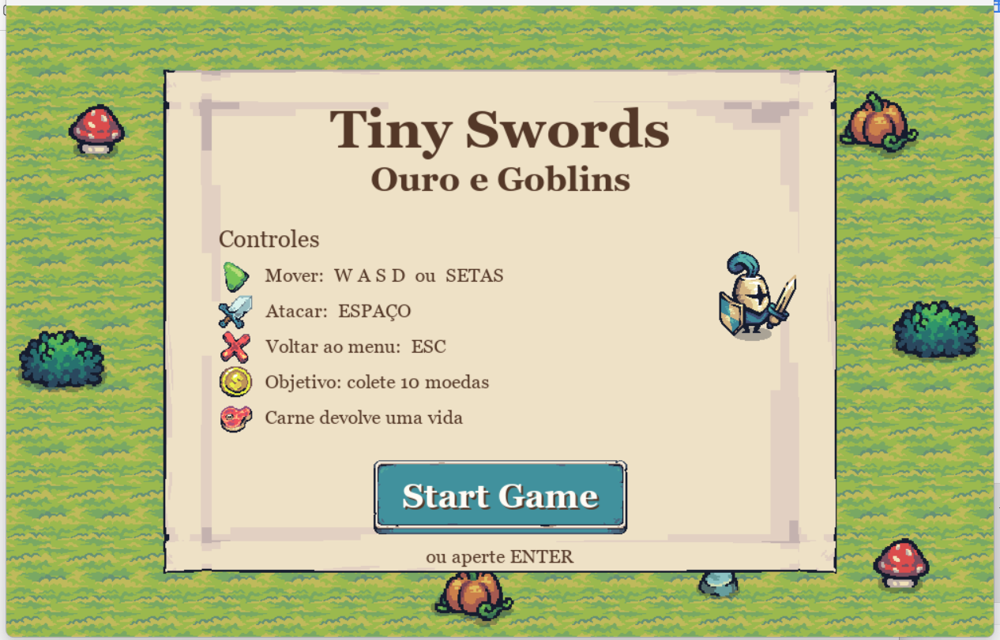
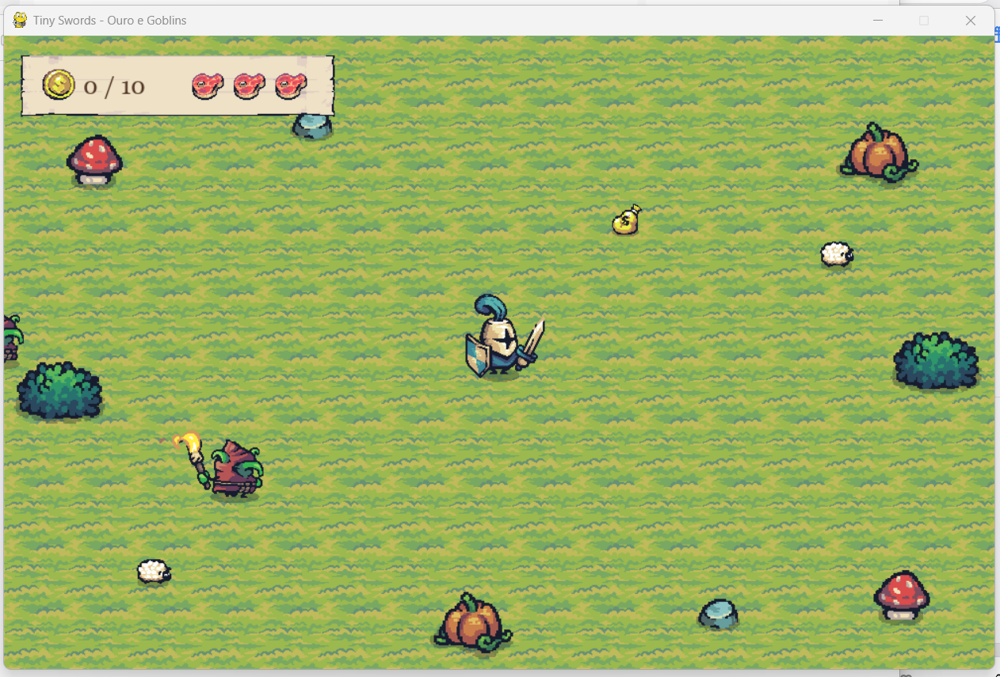
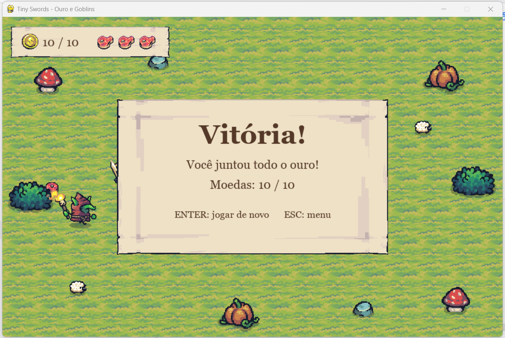
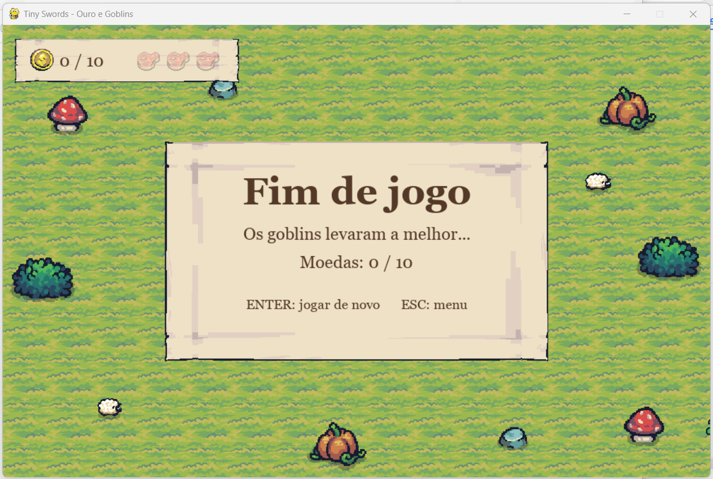

# Tiny Swords - Ouro e Goblins

Projeto desenvolvido como atividade acadêmica da disciplina **Linguagem de Programação Aplicada**, do curso de **Ciência da Computação**.

## Sobre o projeto

Tiny Swords - Ouro e Goblins é um jogo 2D desenvolvido em Python, no qual o jogador controla um personagem em um cenário de fantasia medieval. O objetivo principal é coletar 10 moedas de ouro enquanto enfrenta goblins e administra suas vidas durante a partida.

## Demonstração do jogo

### Menu inicial

### Gameplay

### Tela de vitória

### Tela de derrota

## Funcionalidades

- Movimentação do personagem utilizando as teclas WASD ou as setas do teclado.
- Sistema de combate, permitindo atacar os goblins utilizando a tecla ESPAÇO.
- Geração aleatória de moedas, com uma nova moeda aparecendo após a coleta da anterior.
- Sistema de vidas, com três vidas disponíveis inicialmente.
- Recuperação de vidas por meio da coleta de carnes deixadas ocasionalmente pelos goblins derrotados.
- Sistema de vitória ao coletar as 10 moedas de ouro.
- Sistema de derrota quando todas as vidas são perdidas.
- Menu inicial com instruções de controles e objetivo.
- Opção de reiniciar a partida ou retornar ao menu após o encerramento do jogo.

## Mecânicas do jogo

Durante a partida, o contato com os goblins reduz uma vida do jogador. Ao derrotar determinados goblins, eles podem deixar carnes que recuperam uma vida cada. Caso o jogador já esteja com todas as vidas preenchidas, a carne coletada não aumenta a quantidade de vidas.
As moedas são geradas aleatoriamente e aparecem individualmente, mantendo o objetivo de coletar 10 unidades para concluir a partida.

## Tecnologias utilizadas

- Python.
- Pygame.
- Módulos nativos do Python: math, os, random e sys.

## Status do projeto

Projeto acadêmico com demonstração funcional, contemplando mecânicas de movimentação, combate, coleta de itens, gerenciamento de vidas e condições de vitória e derrota.

## Observações

Os recursos gráficos utilizados no projeto foram obtidos de fontes gratuitas disponíveis na web. Os elementos visuais foram integrados ao jogo para compor o cenário, personagens e itens.
Este é um projeto acadêmico independente, desenvolvido em Python e Pygame. Os recursos gráficos foram criados por Pixel Frog e utilizados conforme as condições de sua licença. **O projeto não possui vínculo oficial com a autora dos assets.**

## Créditos dos recursos gráficos

- Autora: **Pixel Frog.**
- Pacote de assets: **Tiny Swords: Warfare**(https://pixelfrog-assets.itch.io/tiny-swords-warfare).
- Plataforma: itch.io.
